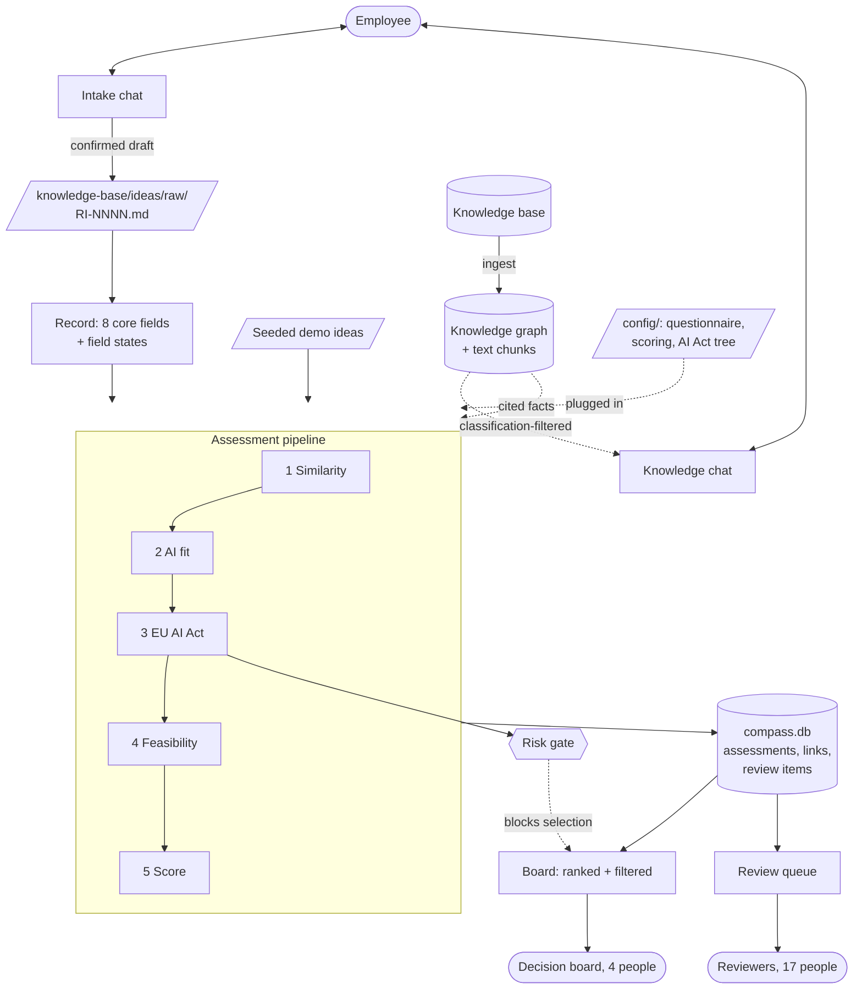

# AI Compass: Architecture

Employees submit ideas through chat. An agent pipeline turns each one into a
consistent record, screens it, scores it and links it to related ideas. A small
decision board reviews the ranked result.

**The agent recommends. The decision team decides.**

## 1. Overview



## 2. Components

| Component | Responsibility | Reads | Writes |
|---|---|---|---|
| Intake chat (`employee_interface/`) | Employee describes an idea; agent asks for what is missing and never invents | Employee list | `RI-NNNN.md` |
| Knowledge chat (`compass/app.py`) | Answers questions about the company, cited, within the asker's access role | Text chunks | — |
| Record (`compass/records.py`) | One shape for every submission: 8 core fields, each with a state | Raw files, seeds | `core_fields` |
| Knowledge graph (`compass/kg/`) | Turns the knowledge base into queryable, citable facts | `knowledge-base/` | `kg_node`, `kg_edge`, `kb_chunk` |
| Agent 1: Similarity | Finds ideas elsewhere that need the same thing built | Portfolio | `overlaps` |
| Agent 2: AI fit | AI, conventional automation, hybrid, or more research | Record, graph | `assessments` |
| Agent 3: EU AI Act | Art. 5 / Art. 6 + Annexes / Art. 50, with citations | Record, policies | `assessments` |
| Agent 4: Feasibility | Skills, systems, data, capacity, budget, compliance, strategy | Record, graph | `assessments` |
| Agent 5: Score | Configurable RICE | Record, feasibility, config | `assessments` |
| Risk gate | Decides whether an idea may be selected. **Never sees the score** | Risk assessment | — |
| Board (`compass/app.py`) | Ranked, filterable portfolio with full reasoning | `compass.db` | `decisions` |
| Review queue | Every gap the agent refused to guess, assigned to a person | `review_items` | — |

## 3. Data model

Raw ideas are files; everything derived is SQLite and regenerable.

```
RawIdea file   knowledge-base/ideas/raw/RI-NNNN.md
               front matter: id, author_id, created_at, classification
               sections: the employee's own words, never edited by an agent

UseCase        { id, title, author_id, department, source, status, version }
CoreField      { use_case_id, field_key, value, state, evidence }
                 state ∈ provided | unclear | missing | assumed
Assessment     { use_case_id, version, kind, payload, model,
                 config_name, config_version, created_at }
                 kind ∈ similarity | ai_fit | risk | feasibility | score
Overlap        { a_id, b_id, similarity, verdict, rationale, status }
ReviewItem     { use_case_id, reason, field_key, severity, assignee_id, status }
Decision       { use_case_id, decision, actor_id, note, created_at }
RankSnapshot   { config_name, config_version, payload }
```

`state` is the load-bearing idea. A field the employee did not provide is
`missing`, and the pipeline reasons about the absence instead of filling it.
`assumed` marks a value an agent supplied; it is displayed as such and never
counts as evidence.

## 4. The three contracts

Each is a file, changeable without touching code.

**`config/intake-questionnaire.yaml`** — the eight core fields: problem,
intended purpose, users and affected people, deployment context, data, expected
benefit, effort, human oversight. Each declares `why_needed`, `consumed_by`
(which agent cannot work without it), `validation`, `follow_up_triggers` and an
explicit `never`. An `extensions` block adds per-client questions while the
eight stay fixed, so records remain comparable across tenants.

**`config/scoring/*.yaml`** — `name`, `version`, `formula`, bands, scales and
Confidence caps. Changing the active config re-scores the portfolio and
produces a diff naming every move and its cause.

**`config/risk/eu-ai-act.yaml`** — the screening tree with a citation on every
branch, and `blocks_verdict_when_missing`, which states which absent field
forbids which verdict.

## 5. Flows

1. **Submit** — intake chat → employee confirms → `RI-NNNN.md` written.
2. **Record** — the file is parsed into the 8 core fields. Fields the intake
   chat does not yet collect arrive `missing`, not inferred.
3. **Assess** — similarity → AI fit → risk → feasibility → score. Order
   matters: "this is not an AI system" changes the risk conversation, and RICE
   Effort comes from the feasibility estimate rather than being invented twice.
4. **Gate** — Art. 5 blocks selection outright; high-risk or incomplete
   screening blocks it pending a named reviewer.
5. **Review** — every gap becomes a review item assigned to the submitter or
   to a reviewer.
6. **Decide** — the board filters by budget, people, days, department,
   verdict and risk, reads the full reasoning, and selects, parks or rejects.
7. **Re-weight** — a new scoring config re-ranks everything and shows the diff.
   Risk and feasibility are not recomputed: they are properties of the idea,
   not of how the board weights value.

## 6. Invariants

- Raw idea files are never edited or deleted by an agent.
- Nothing the employee did not say is recorded as fact. Unsupported values are
  `missing` or `assumed`, and `assumed` is visible.
- The EU AI Act screening never returns `minimal` while a field it needs is
  absent; it returns `insufficient_information` and raises a review item.
- **No business score can clear a risk gate.** The gate function does not
  receive the score.
- Every non-minimal risk verdict cites an article or annex point.
- Every feasibility dimension cites the knowledge base paths it was decided
  from.
- One ranking uses one scoring config. Ideas that cannot be scored are shown as
  unscored rather than ranked at zero.
- The knowledge base's `classification` is enforced server-side on retrieval;
  an employee is shown only what their access role allows.
- Authorization is checked in `compass/views.py` on every call, not by hiding a
  tab.
- Deleting `compass.db` loses no employee input.

## 7. Deliberate limits

- The screening is triage for a human, never a conformity assessment.
- Offline verdicts are keyword rules: correct and conservative, but thinner
  than a model's, and thresholds are tuned to this portfolio.
- Overlap detection is lexical similarity plus capability signatures.
  Embeddings would be better and are the next step.
- Demo logins are plain text on localhost and would be SSO in anything real.
