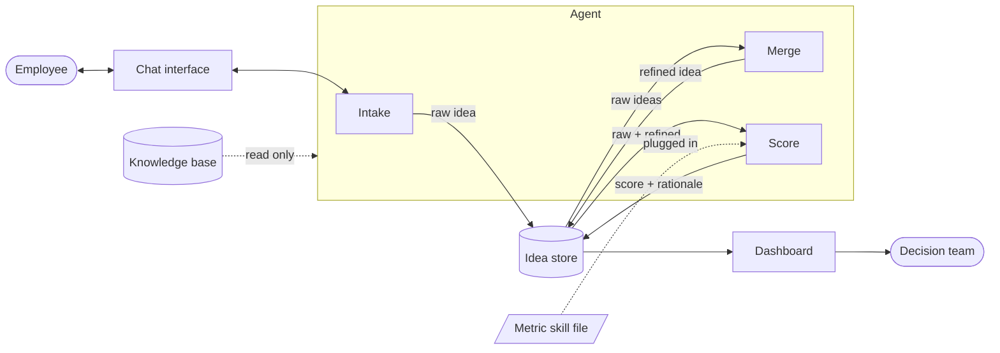

# Idea Evaluation System: Architecture

Employees submit ideas through chat. An agent merges related ideas and scores them. A decision team reviews the ranked list.

## 1. Overview



## 2. Components

| Component | Responsibility | Reads | Writes |
|---|---|---|---|
| Chat interface | Employee submits an idea and answers follow-up questions | - | - |
| Agent: Intake | Turns the conversation into one raw idea, confirmed by the employee | Knowledge base | RawIdea |
| Agent: Merge | Finds related raw ideas and combines them into a refined idea | RawIdea, RefinedIdea, knowledge base | RefinedIdea |
| Agent: Score | Applies the metric to one idea at a time | Idea, metric, knowledge base | Score |
| Idea store | Holds ideas, merge links and scores | - | - |
| Knowledge base | Company context | - | - |
| Metric skill file | Defines how ideas are judged | - | - |
| Dashboard | Lists raw and refined ideas, ranked by score | Idea store | - |

## 3. Data model

```
RawIdea      { id, author_id, text, created_at }
RefinedIdea  { id, version, text, source_ids[2..n], updated_at }
Score        { idea_id, idea_version, metric_name, metric_version,
               value, rationale, scored_at }
```

- A raw idea can feed several refined ideas.
- A raw idea has version 1 for scoring purposes.

## 4. Metric contract

The metric is a skill file that can be swapped without code changes.

```markdown
---
name: <metric name>
version: <integer>
scale: 0-100
---
<criteria, weights and scoring instructions>
```

- **Input:** idea text and knowledge base access. No author identity.
- **Output:** `{ value, rationale }`

## 5. Flows

1. **Submit:** chat → Intake → employee confirms → RawIdea stored.
2. **Merge:** a new RawIdea triggers Merge, which creates a RefinedIdea, adds a source to an existing one (new version), or does nothing.
3. **Score:** every new or changed idea is scored.
4. **Metric change:** a new metric version rescores all ideas.
5. **Review:** the dashboard sorts stored scores of the active metric. Refined ideas link to their sources.

## 6. Invariants

- Raw ideas are never edited or deleted by Merge.
- Every refined idea is traceable to its source ideas.
- One ranking uses one metric version only. Ideas not yet scored under it are shown as pending.
- The agent recommends. The decision team decides.
- Intake shows an employee only knowledge base content that employee is allowed to see.
